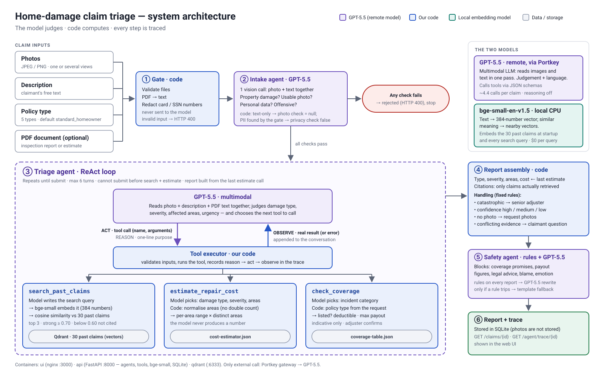
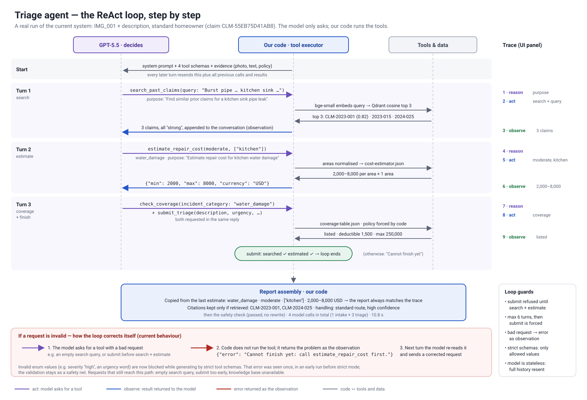

# Home-Damage Claim Triage

A multi-agent system that gives every home-damage claim a fast, consistent and auditable first triage.
A claim (photos, description, policy type, optional PDF) goes in; a structured report comes out —
damage type, severity, affected areas, a repair-cost range, urgency, similar past claims and how the claim
should be handled — together with a trace of every step the agent took.

## Run it

Requirements: Docker with Compose v2 and GNU Make.
The only external credential is an LLM gateway key: copy `starter-kit/.env.example` to `starter-kit/.env`
and fill in `PORTKEY_API_KEY`, `PORTKEY_BASE_URL` and `LLM_MODEL` (any OpenAI-compatible endpoint works).

```sh
cd starter-kit
make setup         # build, start qdrant + api + ui, wait until healthy
make test          # 80 offline tests (scripted fake model, no paid calls)
```

- UI: <http://localhost:3000> · API: <http://localhost:8000/api/v1/health>
- The embedding model (~65 MB) is downloaded at build time; at runtime the only external call is the LLM.
- Other targets: `make reindex` (re-embed all claims), `make logs`, `make stop`.

## Architecture



| Step | Who | What |
|---|---|---|
| ① Gate | code | Validates files, extracts PDF text, redacts card/SSN numbers before anything reaches a model |
| ② Intake agent | GPT-5.5 + code rules | One vision call → 4 checks; any fails → HTTP 400, no triage. Text-only → `is_valid_image: null` |
| ③ Triage agent | GPT-5.5 decides, code executes | ReAct loop over 3 tools (below), ends with `submit_triage` |
| ④ Report assembly | code | Scope and cost copied from the last estimate; citations limited to retrieved claims; handling rules |
| ⑤ Safety agent | rules + GPT-5.5 | Blocks coverage promises, payout figures, legal advice, blame, emotional tone; rewrite or template |
| ⑥ Storage | code | Report + trace in SQLite → `GET /claims/{id}`, `GET /agent/trace/{id}` |

### The ReAct loop



The model never runs a tool: it returns a tool call (name + arguments), our code runs it and sends the
result back. Each call carries a required `purpose` sentence, logged as the reason step; the tool and
its inputs are the act; the real output is the observe.

| Tool | Model provides | Code does |
|---|---|---|
| `search_past_claims` | search query | embed with bge-small → Qdrant cosine top 3; cite only ≥ 0.60 (≥ 0.70 = strong) |
| `estimate_repair_cost` | damage type, severity, areas | normalise areas; per-area range from `cost-estimator.json` × distinct areas |
| `check_coverage` | incident category | policy taken from the request; lookup in `coverage-table.json` (indicative) |
| `submit_triage` | urgency, description, recommendation, citations | refused until search and estimate have run; ends the loop |

Guards: at most 6 turns (then submit is forced); invalid requests come back as an error observation and the
model retries; strict tool schemas restrict values while generating.

## Key choices

- The model judges, code computes. GPT-5.5 decides what happened, how severe, where and how urgent.
  Cost, coverage, citations, routing and confidence are deterministic code over the cost and coverage
  tables, and the report is built from the trace's own tool results, so the two cannot disagree.
- LLM: GPT-5.5 via Portkey (Chat Completions); handles images and tool calls. Only portable features are
  used (image parts, tool calls, forced tool choice for structured output),
  so changing `LLM_MODEL` is the only change needed to try another model.
- Reasoning off. GPT-5.5 rejects tools combined with reasoning on Chat Completions. I kept the portable
  API rather than switching to the OpenAI-specific Responses API, and measured accuracy instead.
- Hand-written loop, no agent framework. ~150 lines; the trace format is produced directly and
  every step is testable.
- Embeddings: local `bge-small-en-v1.5` (fastembed, quantized ONNX, 384 dimensions, cosine). No extra
  credential and no per-query cost. One vector per claim; the incident (type, areas, description, adjuster
  notes) is embedded, the outcome is stored as payload only. Quantized precision is enough for 30 records;
  at production scale I would move to a larger model and re-run the benchmark.
- Qdrant, incremental indexing. Each point stores a hash of its file; only changed claims are
  re-embedded at startup, with a warning naming them.
- Similarity bands from data. Unrelated text scored ≤ 0.53, genuine precedents ≥ 0.69, so nothing below
  0.60 is cited. Because cosine measures wording rather than cause (a car through a fence scored 0.74
  against vandalism), code also checks that a precedent shares the assessed damage type.
- Handling instead of a single review flag. A first version flagged 31 of 35 claims for human review.
  Now: catastrophic → senior adjuster; no photo → low confidence + photo request; conflicting evidence →
  one specific question for the claimant; no or weak precedent → medium confidence; the rest are advisory notes.
- Severity: under-rating is the costlier error for an insurer, so when evidence fits two levels the agent
  picks the higher one.
- Privacy. Sensitive identifiers (cards, SSNs, IBANs, IDs) are rejected and redacted before text leaves the
  service; incidental context such as house numbers is allowed.
- Labelled evaluation data is never used at runtime; only the knowledge base and tool tables are mounted
  into the API container.

More detail: `starter-kit/DECISIONS.md`.

## Results (summary)

On a 35-claim labelled development set: damage type 35/35; severity 0.86 (25/35 exact); cost 0.62; ~14 s and ~$0.06 per
claim. Details, method and caveats in `RESULTS.md`.

## Limitations

- Severity: 4 of 35 development claims are still rated one level too low; the rubric was tuned on the same
  35 cases with one run per configuration, so accuracy on new claims is likely lower.
- The demo UI combines the claimant's submission form and the adjuster's full report; in production the
  claimant should only see `handling.claimant_requests`.
- Policy type is trusted from the request; scanned PDFs without a text layer contribute no text.
- On large losses the model can split damage into too many areas (IMG_019: 6 areas vs 3 labelled).
- Safety checks are rule-based (with an LLM rewrite); subtle unsafe phrasing could pass.
- Synchronous processing (~12–15 s per request), no authentication, single-node SQLite.
- `submit_triage` (and a refused early submit) is not recorded as a trace step.

## Next steps

1. Validate severity on held-out claims and test a reasoning call for the visual assessment.
2. Validate the business assumptions (tie-break upward, catastrophic routing, confidence rules) with the
   claims team.
3. Separate claimant portal and adjuster console; cheaper model for intake and safety; async queue.
4. Look up policy details from a policy system; render scanned PDFs as images.

## Repository

```
starter-kit/
  api/app/            FastAPI service: main.py, agents/, tools/, rag.py, llm.py, pii.py, store.py
  api/tests/          80 offline tests
  ui/                 index.html + nginx.conf
  DECISIONS.md        decision log
docs/                 architecture and ReAct-loop diagrams (SVG + PNG)
```
